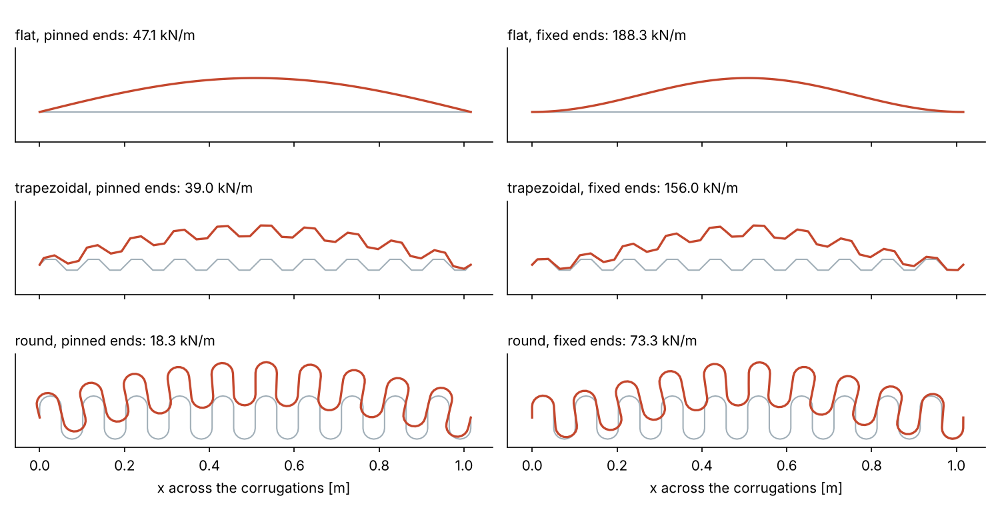
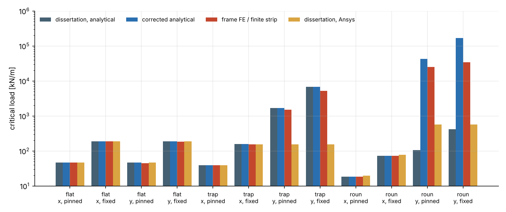
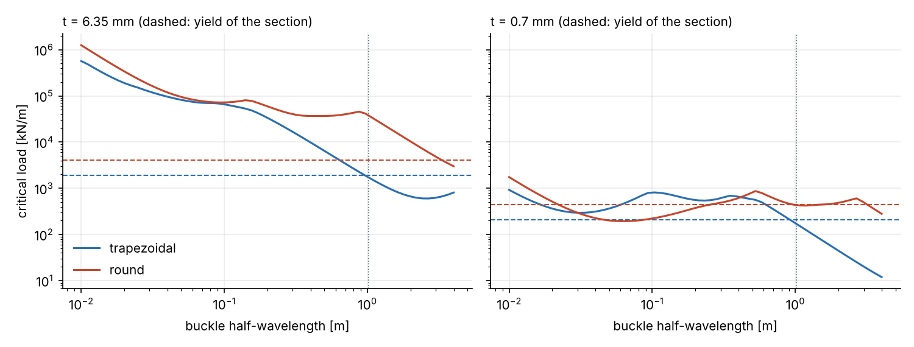

# Buckling of corrugated panels

Critical buckling loads of flat, trapezoidal and round corrugated panels under
uniaxial compression, from three independent models:

| Model | Load direction | What it is |
|---|---|---|
| Equivalent orthotropic plate | both | Closed-form homogenisation of the corrugation (Xia, Friswell and Saavedra Flores, 2012) with the Euler load of a wide strut |
| Frame finite elements | across the corrugations | The real profile meshed with plane-strain beam elements, linear eigenvalue buckling |
| Finite strips | along the corrugations | Every flat of the profile as a plate strip with membrane and bending action; local and global buckling in one model |

**Interactive simulator:** https://veloyfernandes.com/buckling/

This is a rebuilt and corrected version of my MSc dissertation, *Buckling
Analysis of Corrugated Panels* (Swansea University, 2023, supervised by
Dr Yuying Xia). The dissertation compared the equivalent plate model with Ansys
eigenvalue buckling. Here the Ansys step is replaced by two solvers written
from plate and beam theory, which made it possible to check every case.



## Results for the dissertation case

1.016 m square panel, 6.35 mm steel sheet (E = 210 GPa, ν = 0.3, yield 250 MPa).
Trapezoidal: depth 25.4 mm, half period 50.8 mm, 45° webs. Round: crest radius
25.4 mm, 50.8 mm straights. Loads in kN per metre of loaded edge.

| Panel | Load | Ends | Dissertation, analytical | Corrected analytical | Numerical (this repo) | Dissertation, Ansys | Yield limit |
|---|---|---|---:|---:|---:|---:|---:|
| Flat | across | pinned | 47.1 | 47.1 | 47.1 | 47.1 | 1,588 |
| Flat | across | fixed | 188.3 | 188.3 | 188.3 | 188.2 | 1,588 |
| Trapezoidal | across | pinned | 39.0 | 39.0 | 39.0 | 38.8 | 122 |
| Trapezoidal | across | fixed | 156.0 | 156.0 | 156.0 | 155.8 | 122 |
| Trapezoidal | along | pinned | 1,703 | 1,703 | 1,502 | 154.7 | 1,916 |
| Trapezoidal | along | fixed | 6,811 | 6,811 | 5,224 | 154.7 | 1,916 |
| Round | across | pinned | 18.3 | 18.3 | 18.3 | 19.6 | 32 |
| Round | across | fixed | 73.3 | 73.3 | 73.3 | 78.4 | 32 |
| Round | along | pinned | 105.2 | 42,427 | 25,009 | 567.1 | 4,081 |
| Round | along | fixed | 420.8 | 169,707 | 34,195 | 567.1 | 4,081 |

Numerical values along the corrugations are finite strip results with free side
edges; with the side edges held they are 1,722 and 36,831 kN/m (pinned).
Reproduce the table with `python scripts/reproduce_tables.py`.



## What changed from the 2023 dissertation

1. **Corrugation does not always help.** Across the corrugations the panel is
   softer than the flat sheet it is made from, by the factor c/l (flat 47.1,
   trapezoidal 39.0, round 18.3 kN/m). The benefit is along the corrugations
   only. The dissertation's conclusion that round panels resist buckling best
   holds for that direction alone.
2. **Round corrugation stiffness.** The MATLAB script had an operator
   precedence slip (`Rl/2*R` for `Rl/(2*R)`), used `D66` where `A66` belongs,
   and carried the wrong `A22` into `D22`. The bending stiffness along a round
   corrugation is 4.44 MN·m, not 11.0 kN·m. The corrected script is in
   [`matlab/`](matlab/corrugated_buckling.m).
3. **Ansys results along the corrugations.** For both corrugated panels the
   Ansys load was identical for pinned and fixed ends and far below theory. The
   finite strip model here agrees with theory, so those four values most likely
   came from boundary conditions that did not act on the mode found. They are
   kept in the table for reference and should not be used.
4. **Yield.** Along the corrugations this thick panel yields long before it
   buckles elastically. `analytical.squash_load` and the EN 1993-1-1 column
   curve in `analytical.design_resistance` give the governing limit.
5. **Units.** Loads are line loads in N/m. Young's modulus was printed once as
   21 GPa; 210 GPa was used throughout.

What held up: the flat panel results, and both corrugated panels across the
corrugations, agree with the frame finite element model to within 0.2%.



With the 6.35 mm sheet (left) every buckling mode along the corrugations lies
above the yield line. With a 0.7 mm sheet (right) local buckling of the flats
takes over at short half-wavelengths.

## Use

```bash
pip install -r requirements.txt
python scripts/reproduce_tables.py     # the table above
python scripts/make_figures.py         # figures in docs/figures
python -m pytest                       # 17 checks against closed-form results
```

```python
import numpy as np
from corrugated_buckling import Sheet, trapezoidal, equivalent_plate, analytical, frame_fe, finite_strip

sheet = Sheet(E=2.1e11, nu=0.3, t=0.00635)
profile = trapezoidal(f=0.0127, c=0.0508, theta=np.pi / 4)

plate = equivalent_plate(sheet, profile)                      # A and D terms
N_across = frame_fe.buckle(sheet, profile, length=1.016, ends="pinned")[0]
N_along, m = finite_strip.panel_load(sheet, profile, width=1.016, length=1.016)
N_yield = analytical.squash_load(sheet, profile, "y")
```

## Layout

```
corrugated_buckling/
  profiles.py       geometry of one corrugation, I1 and I2 integrals
  homogenise.py     equivalent orthotropic plate stiffness
  analytical.py     Euler strut, orthotropic plate, yield and design load
  frame_fe.py       frame finite elements, load across the corrugations
  finite_strip.py   finite strips, load along the corrugations
  dissertation.py   the 2023 case and its reported values
matlab/             corrected MATLAB script
scripts/            table and figures
tests/              pytest checks
```

## Limits

Linear elastic eigenvalue buckling of a perfect panel under uniform end
compression. No imperfections, post-buckling or shear deformation; isotropic
sheet. Fixed ends along the corrugations use the effective length. The design
load from the column curve is an indication, not a code check.

## Reference

Y. Xia, M. I. Friswell, E. I. Saavedra Flores (2012). Equivalent models of
corrugated panels. *International Journal of Solids and Structures* 49,
1453-1462.

## Licence

MIT
